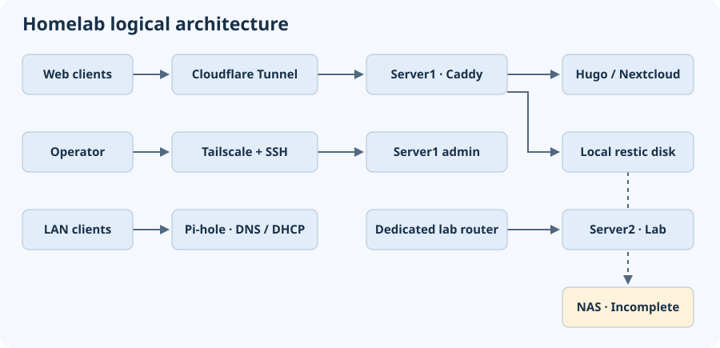

# Homelab Operations Portfolio

I run a self-hosted Hugo site and Nextcloud on Ubuntu. This portfolio covers three parts of operating the lab: how traffic reaches the services, how I ship changes, and how I diagnose and recover from failures.

- **Service design.** Caddy serves Hugo and routes Nextcloud on Server1. Cloudflare Tunnel carries public web traffic. Tailscale and SSH provide a separate administration path. Pi-hole serves LAN DNS and DHCP, and Server2 sits on a separate lab segment. [Architecture](docs/architecture.md)
- **Release workflow.** A systemd timer on Server1 pulls changes from GitHub for the Hugo blog. The release procedure describes the build gate, public checks, and how to return to a known-good revision. [Deployment](docs/deployment.md)
- **Incident response.** I recovered DNS and certificate renewal after a Tailscale interruption, then fixed stale Cloudflare DNS records and a separate Caddy routing issue. [Incident notes](docs/incidents.md)
- **Recovery status.** A manual restic backup completed on a dedicated local disk. A later scheduled run failed. The NAS copy is incomplete and a restore drill is outstanding. [Backup and recovery](docs/backup-recovery.md)

The portfolio draws on October 2026 incident records and a November 3, 2026 host review. The detailed pages distinguish observations from procedures and open checks.
