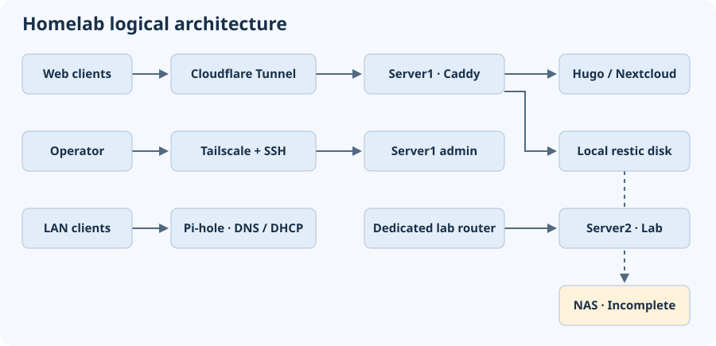

# Architecture

| Component | Responsibility | Evidence |
| --- | --- | --- |
| Server1 | Ubuntu host for Caddy, the Cloudflare Tunnel connector, Hugo sites, and Nextcloud with PHP-FPM and MariaDB. A dedicated internal disk holds the local restic repository. | Service and storage roles recorded in the November 3 host review. |
| Server2 | Separate experimental host behind a dedicated lab router. | Placement owner-confirmed November 3. Comprehensive traffic filtering and reboot persistence were outside the recorded checks. |
| Pi-hole | LAN DNS and DHCP. The October records also document its use for Tailscale DNS. | DHCP response checked in October. Normal operation owner-confirmed November 3. |
| NAS | Intended cold copy destination. | Incomplete transfer and standby state owner-confirmed November 3. |

## Traffic paths

- **Public web:** Clients connect to the Cloudflare edge. The tunnel connector on Server1 passes origin requests to Caddy, which routes by hostname to the relevant site or app. The tunnel replaced inbound forwarding after an ISP change removed stable public IPv4.
- **Administration:** The operator uses SSH over Tailscale. Host DNS needs an independent working path so an overlay interruption does not also break routine resolution and certificate renewal.
- **Local clients:** Pi-hole handles LAN DNS and DHCP. October records describe local DNS overrides for selected services. One desktop's IPv6 DNS bypass was addressed, with other clients still unverified.
- **Lab:** The dedicated router separates Server2 from the service LAN at the topology level. That placement alone does not demonstrate a deny policy across routed paths.

## Observability

Prometheus and Grafana live verification remains open. The incident evidence comes from recorded DNS, service and public endpoint checks rather than a verified monitoring dashboard.

[Back to overview](../README.md)
